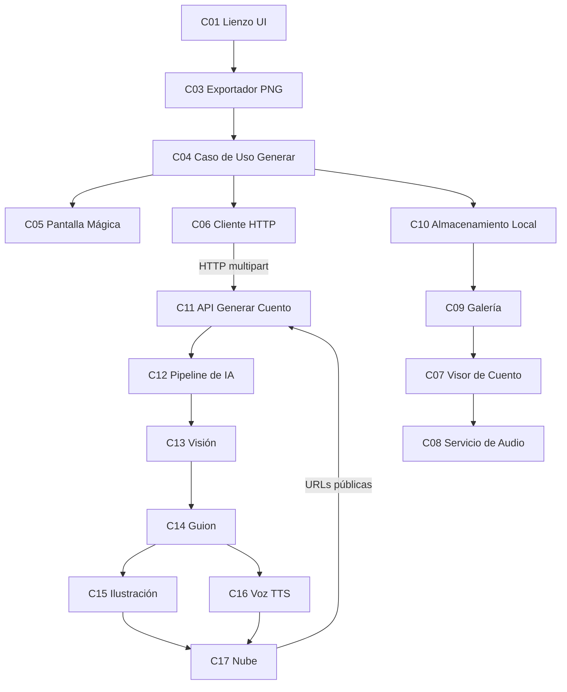

# Mapa de Componentes v1 — StoryDraw

## Módulos principales

| Módulo | Nombre | Responsabilidad |
|--------|--------|-----------------|
| **M1** | Creación (Dibujo) | Lienzo donde el niño dibuja y exporta su trazo. |
| **M2** | Generación | Orquesta el envío del dibujo y la espera del cuento. |
| **M3** | Consumo (Cuento) | Muestra y narra el cuento página a página. |
| **M4** | Biblioteca | Guarda/lista cuentos y controla el límite gratuito. |
| **M5** | API + Pipeline de IA (backend) | Convierte el dibujo en cuento ilustrado y narrado. |
| **M6** | Almacenamiento en la nube | Hospeda imágenes/audios y entrega URLs públicas. |

## Componentes por módulo

| ID | Componente | Tipo | Módulo |
|----|-----------|------|--------|
| C01 | Lienzo de Dibujo | UI | M1 |
| C02 | Barra de Herramientas | UI | M1 |
| C03 | Exportador de Lienzo a PNG | Servicio | M1 |
| C04 | Caso de Uso Generar Cuento | Servicio | M2 |
| C05 | Pantalla Mágica (espera) | UI | M2 |
| C06 | Cliente HTTP / DataSource | Integración | M2 |
| C07 | Visor de Cuento | UI | M3 |
| C08 | Servicio de Audio | Servicio | M3 |
| C09 | Galería | UI | M4 |
| C10 | Almacenamiento Local | Datos | M4 |
| C11 | API Generar Cuento | Servicio | M5 |
| C12 | Pipeline de IA | Servicio | M5 |
| C13 | Servicio de Visión | Integración | M5 |
| C14 | Servicio de Guion | Integración | M5 |
| C15 | Servicio de Ilustración | Integración | M5 |
| C16 | Servicio de Voz (TTS) | Integración | M5 |
| C17 | Almacenamiento en la Nube | Integración/Datos | M6 |

*Clasificación por tipo:* **UI** = C01, C02, C05, C07, C09 · **Servicio** = C03, C04, C08, C11, C12 ·
**Datos** = C10, C17 · **Integración** = C06, C13, C14, C15, C16.

## Dependencias principales

**Dependencias en texto (por si el diagrama no renderiza):**
- C01 → C03 → C04 (el trazo se exporta a PNG y se entrega al caso de uso).
- C04 → C06 → C11 → C12 (el caso de uso llama al backend, que ejecuta el pipeline).
- C12 → C13 → C14 → (C15 ∥ C16) → C17 (visión → guion → ilustración y voz en paralelo → nube).
- C04 → C10 → C09 → C07 → C08 (se persiste local, se lista en galería, se abre en el visor y se narra).

## Notas de alcance

- **Incluye en MVP:** C01–C17. La app ya realiza el flujo completo *dibujo → cuento de 3 páginas
  ilustrado y narrado*, con persistencia local y límite de 3 cuentos gratuitos.
- **Futuro (fuera del MVP):**
  - Cuentas de usuario / login y sincronización entre dispositivos.
  - Compra premium para eliminar el límite de 3 cuentos.
  - Edición o regeneración de una página individual.
  - Selección de estilo visual o de voz; soporte multi-idioma.
